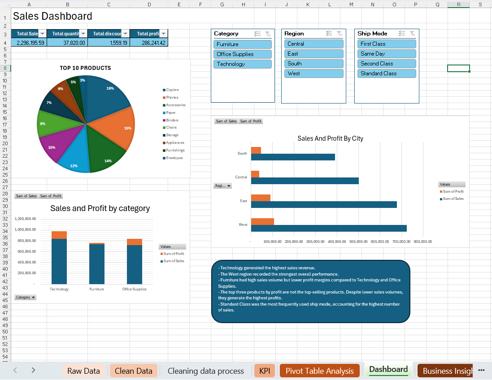

# Superstore Sales Dashboard

An Excel project analysing almost 10,000 sales records from a US retail store.

## What I did
- Cleaned the data: removed duplicates, used TRIM and fixed formats
- Built pivot tables to compare sales and profit by category, region and ship mode
- Made a dashboard with charts and slicers to filter the results
- Wrote key findings and business recommendations

## Key findings
- Technology brought in the highest sales
- The West region performed best overall
- Furniture sells well but has low profit margins

## Tools
Microsoft Excel (pivot tables, charts, slicers, SUM, TRIM)

Download the Excel file to see the full analysis.
